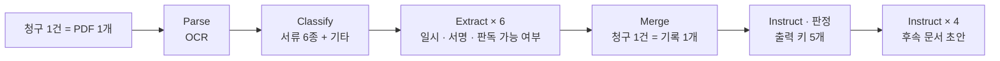

# TimeBar — Tanker Demurrage Claim Evidence Check

[Aramco × KU × Upstage] 2026 Energy AI Workflow Hackathon 최종 제출작 · 팀 TimeBar (1인팀)

유조선이 약속한 시간보다 오래 기다리면 선주는 화주에게 **체선료(demurrage)** 를 청구합니다. TimeBar는 그 청구 서류 묶음을 화주 측 정산 담당자 대신 읽고, 돈을 내기 전에 네 가지를 확인하는 Upstage Studio 워크플로입니다.

> 서류가 다 왔는가 · 서명이 있는가 · 기한 안에 왔는가 · 서류끼리 시각이 맞는가

An Upstage Studio workflow for the charterer's claims handler. It reads one demurrage claim package (one PDF), checks completeness, the terminal signature, the 90-day time bar (BPVOY4 cl. 20.1) and time consistency, returns one of four decisions, and drafts the next document.

| | |
|---|---|
| Studio 라이브러리 | https://studio.upstage.ai/library/agt_4GHMtEjnPkTQzV9KnQgXzn (승인 전에는 열리지 않습니다) |
| 데모 영상 (2분 32초) | [`submission/TimeBar_최종제출_데모영상.mp4`](submission/TimeBar_최종제출_데모영상.mp4) |
| 발표 자료 | [`submission/TimeBar_최종제출_발표자료.pdf`](submission/TimeBar_최종제출_발표자료.pdf) |
| 워크플로 설정 | [`submission/TimeBar_최종제출_workflow.json`](submission/TimeBar_최종제출_workflow.json) |

## 왜 이 문제인가

- **서류 하나가 청구 전체를 지웁니다.** BPVOY4 용선계약 20.1조는 청구서와 모든 증빙 서류가 양하 완료 후 90일 안에 화주에게 도착하지 않으면 화주가 책임을 면한다고 정합니다.
- **법원이 그대로 집행합니다.** 영국 상사법원 판결 세 건에서 합계 USD 535,784의 체선료 청구가 서류 때문에 소멸했습니다.

  | 사건 | 청구액 | 빠진 것 |
  |---|---|---|
  | The Sabrewing [2007] EWHC 2482 (Comm) | USD 114,887 | 서명 없는 펌핑 기록 |
  | The Adventure [2015] EWHC 318 (Comm), BPVOY4 | USD 364,848 | 항만 기록과 시간표 |
  | MTM Hong Kong [2020] EWHC 700 (Comm) | USD 56,049 | 선하증권 2부 |

- **에너지 회사의 일입니다.** Aramco는 2025년에 하루 평균 630만 배럴의 원유를 수출했습니다. Bahri는 Aramco가 도착지 인도로 파는 원유의 독점 운송사이고 2025년 Aramco 그룹에서 47억 리얄의 매출을 올렸습니다. Bahri의 투자설명서(2014)는 Aramco의 100% 자회사 Bolanter와 맺은 운송계약에서 체선료를 "Bolanter가 약정 시간 안에 선적이나 양하를 못 하면 내는 요율"로 정의합니다.

모든 사실의 출처와 쪽수는 [`docs/brief.md`](docs/brief.md)에 있습니다. 판결문과 회사 공식 문서만 썼습니다.

## 워크플로



판정은 아래 순서로 확인하고, 처음 해당하는 단계에서 멈춥니다.

| 순서 | 판정 | 조건 | 담당자가 받는 것 |
|---|---|---|---|
| 1 | 검토 필요 | 다른 선박 서류, 읽을 수 없는 값, 서류끼리 불일치, 무서명 + 항의서 | 어디를 봐야 하는지 적은 메모 |
| 2 | 기한 위험 | 접수일이 기한일보다 늦음 | 두 날짜를 적은 메모 |
| 3 | 보완 요청 | 필수 서류 누락, 펌핑 기록에 터미널 서명 없음 | 선주에게 보내는 영문 서신 초안 |
| 4 | 지급 검토 가능 | 모든 확인 통과 | 확인한 사실을 적은 메모 |

출력 키는 `claim_no`, `vessel_name`, `decision`, `reason`, `missing_documents` 다섯 개입니다.

출발점은 Use Case 카드 U038(컨테이너 지체료 무료기간 검산)입니다. 화물을 원유 유조선으로, 질문을 "금액이 맞는가"에서 "증빙이 갖춰졌는가"로 바꿨고, 서류를 3종에서 6종으로 늘렸습니다.

## 신뢰성 설계

1. **가려진 값은 채우지 않습니다.** 스캔에서 값이 가려지거나 흐리면 `검토 필요`로 넘깁니다.
2. **계약이 말하지 않으면 가정하지 않습니다.** 서명 없는 펌핑 기록에 항의서가 붙어 있으면 사람에게 넘깁니다. BPVOY4에는 항의서가 서명을 대신한다는 문구가 없습니다.
3. **모델은 계산하지 않습니다.** 기한일은 화주의 접수 기록에서 읽어 접수일과 비교합니다. 90일을 세지 않습니다.
4. **"거절"을 내지 않습니다.** 기한 항변이 법원에서 받아들여지지 않은 판결도 있어(The Amalie Essberger [2019]) 그 결정은 사람의 몫입니다.

## 결과

제출 설정(#7)으로 **84회 실행해 84회 모두** `decision`, `missing_documents`, `claim_no`, `vessel_name`이 기대값과 일치했습니다.

| 묶음 | 건수 | 실행 | 일치 |
|---|---|---|---|
| 제출 데이터셋 (set01~10, 서류 51개) | 10 | 2회씩, 20회 | 20 / 20 |
| 경계값 (워크플로가 본 적 없는 새 조합) | 21 | 64회 | 64 / 64 |
| **합계** | **31** | **84회** | **84 / 84** |

- 실행별 출력과 기대값: [`work/runs/all_v7_84runs.json`](work/runs/all_v7_84runs.json). 값은 Studio 응답 원문에서 읽어 코드로 대조했습니다.
- 대조한 것은 위 네 키입니다. `reason`은 실행마다 표현이 달라 문자열로 세지 않고 읽어서 확인했습니다.
- 정답지는 어느 모델의 출력도 아닌 규칙 코드([`work/gen/cases.py`](work/gen/cases.py))에서 나옵니다. 문서는 모두 가상이며 실제 회사·선박과 무관합니다.

### 여기까지 온 과정

| 설정 | 무엇을 했나 | 결과 |
|---|---|---|
| #2 | 첫 전체 실행 | 9 / 10. 빽빽한 펌핑 기록을 "읽을 수 없음"으로 표시해 set03이 틀림 |
| #3, #4 | 판독 표시를 항만 시간 기록의 가려진 칸으로 한정 | 10 / 10, 두 번 반복해도 같음 |
| — | 경계값 21건을 새로 만들어 실행 | 다른 청구 번호의 접수 기록을 통과시키고, 청구서가 없으면 선박명을 지어냄 |
| #5, #6 | 판정 지시문 보강 | 각각 전에 맞던 사례 하나를 틀려 폐기 |
| **#7** | 서류별 값의 출처와 판정 순서를 지시문에 고정 | **84 / 84** |

자세한 이력은 [`CHANGELOG.md`](CHANGELOG.md)와 [`docs/verification_story.md`](docs/verification_story.md)에 있습니다.

## 저장소 구성

| 경로 | 내용 |
|---|---|
| `submission/` | 제출물: 데이터셋 PDF 10개와 ZIP, 정답지, 워크플로 설정, 발표 자료, 데모 영상 |
| `work/gen/` | 테스트 문서, 정답지, 경계값 묶음, 데모 영상을 만드는 코드 |
| `work/html/` | 데이터셋 문서의 원본 HTML |
| `work/probes/`, `work/probes_v2/` | 경계값 묶음 PDF와 기대값 |
| `work/runs/` | Studio 실행 결과 기록 |
| `tools/` | 제출물 정합성 검사, 실행 결과 대조, PDF 도구 |
| `tests/` | 판정 규칙과 도구의 테스트 (99개) |
| `docs/` | 주제 브리프(출처), 결정 기록, 검증 과정 |
| `.claude/` | 작업에 쓴 Claude Code 서브에이전트와 명령 |

설계서와 유형표는 주최 측 템플릿으로 만든 파일이라 이 저장소에 올리지 않았습니다.

## 다시 만들기

```bash
uv sync
uv run python work/gen/build.py                          # 데이터셋 PDF와 정답지
uv run python tools/check_submission.py                  # 제출물 정합성 검사
uv run python tools/score.py work/runs/run09_v7_full.json # 실행 결과를 정답지와 대조
uv run pytest -q
```

`work/gen/workflow.py`와 `design_doc.py`는 주최 측이 배포한 예시 설정과 템플릿을 입력으로 쓰며, 그 파일들은 재배포할 수 없어 저장소에 없습니다.

## AI 도구를 쓴 방식

- **Upstage Studio**가 문서를 읽고 판정합니다.
- **Claude Code**는 출처 조사, 테스트 문서 생성, 대조 코드 작성, Studio 실행 결과 수집을 맡았습니다.
- 판정 기준과 예외 처리 방침은 사람이 정했고 [`docs/decisions.md`](docs/decisions.md)에 날짜별로 남겼습니다.
